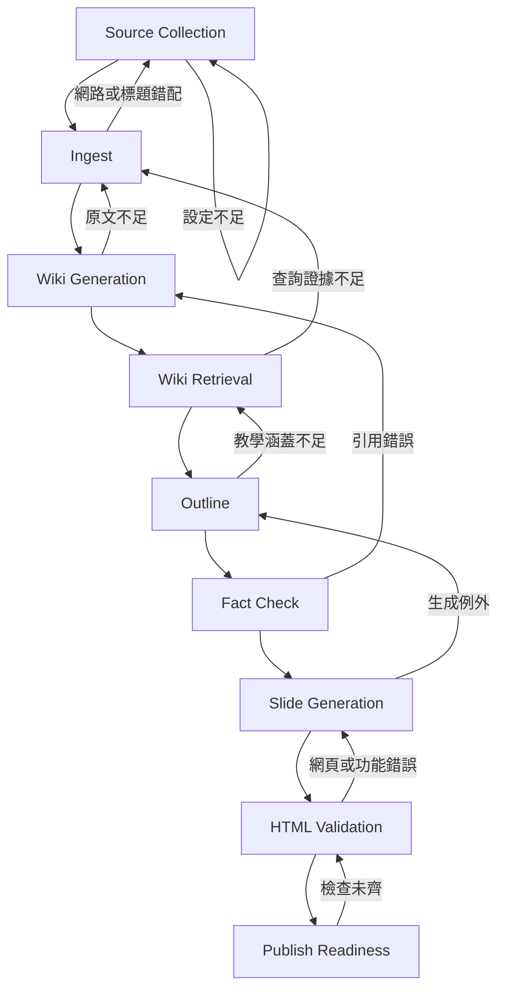

# 有限重試的知識到簡報 Graph

實作位置：`scripts/pipeline.py` 的 NODES、FALLBACK、execute 與 main。這不是僅供展示的圖：例外確實觸發 fallback、計數與停止。每個節點容許初次執行加兩次重試；同一節點第 3 次失敗即停止並留下 traceback。全流程另有 60 次轉移的保護。Ingest 下載每篇另最多嘗試 3 次，且每次 HTTP 有 75 秒 timeout；個別失敗如實寫入 manifest。

|節點|輸入|輸出|通過條件|失敗回退|重試上限|
|---|---|---|---|---|---|
|Source Collection|wiki_plan、來源設定|官方論文 URL 清單|先有規劃、至少 5 個唯一來源 ID|Source Collection|2|
|Ingest|URL 或快取 PDF|raw PDF、頁面文字、chunks、manifest|HTTP／PDF 有效、文字量、第一頁標題一致、至少 5 篇成功；本專案另要求所選來源皆通過|Source Collection|2，單篇下載另 3 次嘗試|
|Wiki Generation|chunks、LLM authored knowledge.json|9 個 Markdown 條目及 index.json|每個 claim 的定位短語必須存在於指定來源／頁碼|Ingest|2|
|Wiki Retrieval|index、投影片查詢|retrieval_results.json|實際檢索結果包含預定教學概念|Ingest|2|
|Outline|retrieval results、教學目標|outline.json／md|每張有檢索依據、至少 10 張|Wiki Retrieval|2|
|Fact Check|claims、chunks、manifest|fact_check.json|來源、頁碼、chunk、短語、URL 一致；本次 LLM 另閱讀語境審閱|Wiki Generation|2|
|Slide Generation|已查核 claims、大綱|site/ 的 HTML/CSS/JS|渲染不拋例外、後續驗證全部連結與功能|Outline|2|
|HTML Validation|site、Wiki、預期功能|靜態／Chromium 報告、截圖、artifact hashes|來源／查詢／引用／張數／JS／RWD／導航全通過|Slide Generation|2|
|Publish Readiness|測試、GitHub preflight|publish_readiness.json|本機產物通過、部署狀態有明確紀錄|HTML Validation|2|

資料不足時不能直接繼續寫投影片：Retrieval 失敗回到 Ingest，接著重新產生 Wiki 與查詢。引用錯誤回到 Wiki Generation。HTML 錯誤回到 Slide Generation。程式不自動編造新來源或替換研究結論；若設定本身需人修改，達上限後停止，由維護者修正再重跑。

Source Collection 由本次代理透過網路搜尋與原始論文頁確認；執行器驗證設定並由 Ingest 再核對真正下載的文件。Wiki Generation 的語意整理來自本次 Codex LLM，儲存於 `content/knowledge.json`，本機重跑是確定性的證據定位與編譯，不是另行呼叫 LLM API。

Publish Readiness 的成功代表本機可交付，**不等於已公開部署**。公開目標、GitHub 權限、遠端部署 URL 必須另依真實狀態回報。GitHub Actions 只上傳 site/，並比對測試時的 artifact SHA-256；若網頁改了卻沒重驗證，拒絕部署。

## 已發生的回退

首次 full run 在 HTML Validation 因 `tests/` 尚未建立而失敗，確實走 `HTML Validation → Slide Generation → HTML Validation` 兩輪，第 3 次失敗停止。見 `runs/20261111T174421Z.json`。修正 validator 的目錄初始化後再次完整執行成功。這也暴露固定回退的限制：重新生成網頁無法修好測試環境，故將初始化提前，而不是擴大重試上限。
